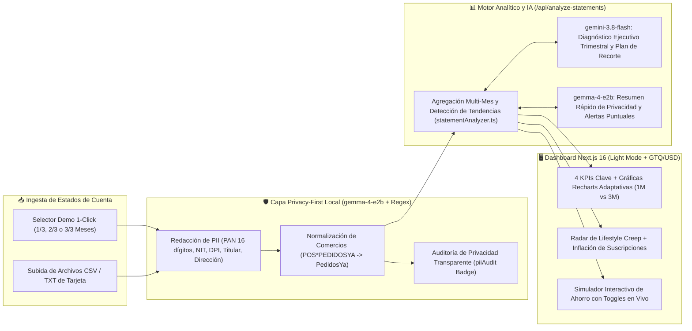
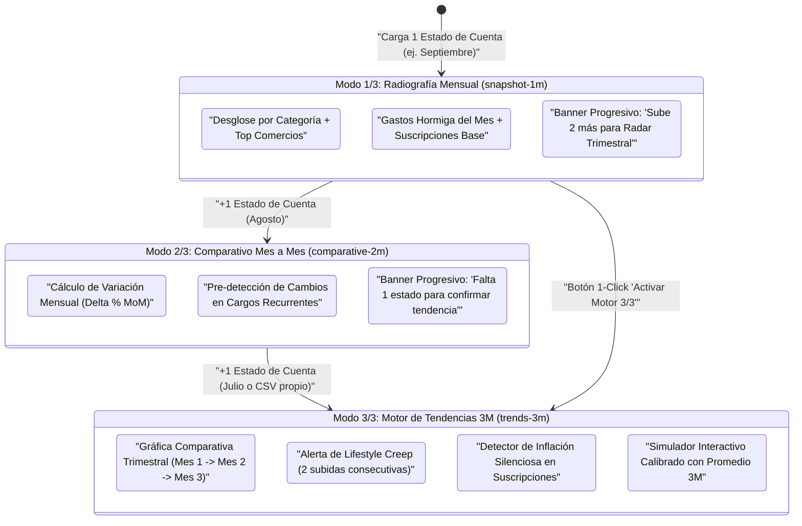
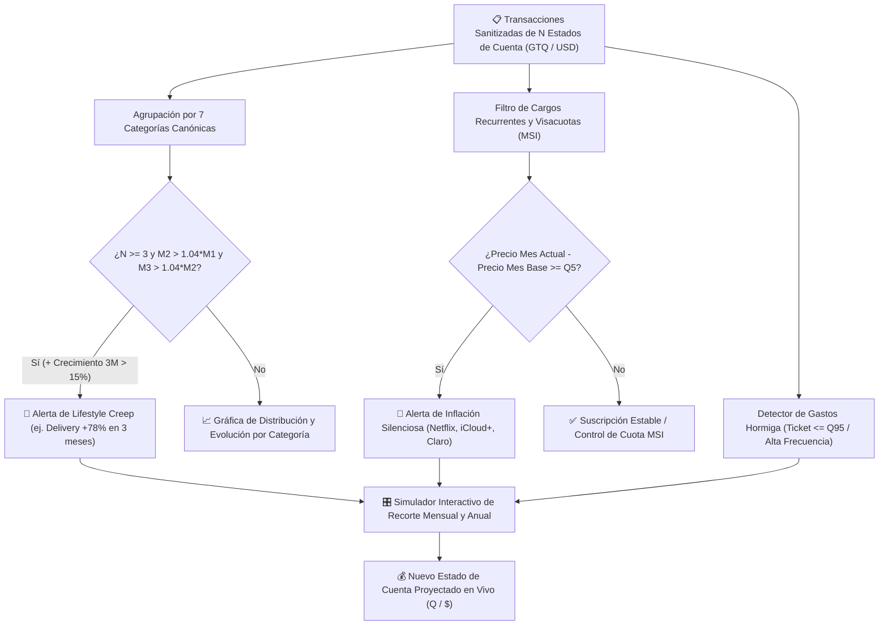

# 💳 Card Statement Insights (`card-statement-insights`)

Analizador progresivo de estados de cuenta de tarjetas de crédito con enfoque **Privacy-First**: **funciona al instante desde 1 solo estado de cuenta (`1/3`)** ofreciendo una radiografía completa del mes, y **desbloquea el Motor de Tendencias Trimestrales al cargar 3 o más estados de cuenta (`3/3`)** para detectar *Lifestyle Creep*, inflación silenciosa en suscripciones y simular recortes interactivos.

> 🚀 **Demo en Vivo (Producción en Vercel):** [**https://card-statement-insights.vercel.app**](https://card-statement-insights.vercel.app)
>
> 📌 **Especificación del Proyecto:** [`SPEC.md`](./SPEC.md) · 📘 **Guía de Onboarding:** [`docs/ONBOARDING.md`](./docs/ONBOARDING.md) · 🛡️ **Arquitectura y Privacidad:** [`docs/ARCHITECTURE.md`](./docs/ARCHITECTURE.md)
>
> 🔗 **Índice General de Prototipos:** [`ykro/hackathon-prototipos-index`](https://github.com/ykro/hackathon-prototipos-index) · 🧪 **Benchmark Gemini 4 Argon & A/B Tests:** [`ykro/gemini-argon-agy-benchmark`](https://github.com/ykro/gemini-argon-agy-benchmark)

---

## 💡 Diseño de Experiencia Progresiva: Funciona con 1, Brilla con 3+

La mayoría de los usuarios abandonan las herramientas financieras si se les exige recopilar medio año de documentos antes de ver el primer gráfico. **Card Statement Insights** elimina esa barrera mediante 3 niveles de profundidad progresiva bimoneda (`GTQ Q` / `USD $`):

| Nivel de Carga | Modo Activo | Qué Desbloquea Inmediatamente en el Dashboard | Banner / Call-to-Action Progresivo |
| :--- | :--- | :--- | :--- |
| **📄 `1/3` Estados de Cuenta** | **Modo Radiografía (`snapshot-1m`)** | • Distribución porcentual por categoría<br>• Top comercios normalizados (`PedidosYa`, `La Torre`, `Café Barista`)<br>• Detector de **Gastos Hormiga** del mes y conteo de visitas<br>• Identificación de suscripciones y Visacuotas (MSI)<br>• Simulador de Ahorro con 3 acciones inmediatas. | *"📊 Estás viendo tu radiografía de 1 mes (1/3). Sube 2 estados de cuenta anteriores para activar el **Radar de Tendencias Trimestrales**."* |
| **📄📄 `2/3` Estados de Cuenta** | **Modo Comparativo (`comparative-2m`)** | • Todo lo anterior + **Variación Mes contra Mes ($\Delta\%_{\text{MoM}}$)** en gasto total y por categoría<br>• Desbloqueo de tarjeta de optimización de movilidad en el Simulador. | *"⚡ ¡Casi listo (2/3)! Agrega 1 estado de cuenta más para confirmar tendencias reales de 3 meses y descartar picos aislados."* |
| **📄📄📄 `3/3+` Estados de Cuenta** | **Modo Tendencias Completo (`trends-3m`)** | • **Gráfica de Evolución Trimestral (`Jul → Ago → Sep`)**<br>• **Alertas de *Lifestyle Creep*** (categorías con 2 alzas consecutivas $>4\%$ y crecimiento $>15\%$)<br>• **Detector de Inflación Silenciosa en Suscripciones** (`Netflix`, `iCloud+`, `Claro`)<br>• **Coach IA Trimestral (`gemini-3.8-flash` vs `gemma-4-e2b`)**. | **Badge Verde:** *"✅ Análisis de Tendencias Trimestrales Activo (3/3 meses)"*. |

---

## 🏗️ Diagramas de Arquitectura y Flujo del Sistema

### Diagrama 1: Arquitectura Privacy-First de Ingesta y Análisis Dual (`gemma-4` Redacción PII + `gemini-3.8-flash` Insights)



---

### Diagrama 2: Máquina de Estados de Experiencia Progresiva (Modo 1/3 Radiografía → Modo 2/3 Comparativo → Modo 3/3 Motor de Tendencias)



---

### Diagrama 3: Flujo del Motor de Detección Trimestral (Lifestyle Creep, Inflación Silenciosa de Suscripciones y Simulador de Recorte)



---

## 🛠️ Inicio Rápido y Documentación Detallada

```bash
npm install
npm run dev
# Abre http://localhost:3000
```

- 📘 **Guía paso a paso para probar los modos `1/3`, `2/3`, `3/3`, subir CSVs y usar el Simulador Bimoneda:** Lee [`docs/ONBOARDING.md`](./docs/ONBOARDING.md).
- 🛡️ **Detalle de expresiones regulares de anonimización PII, normalización de comercios y fórmulas de *Lifestyle Creep*:** Lee [`docs/ARCHITECTURE.md`](./docs/ARCHITECTURE.md).
- 📋 **Especificación original de diseño progresivo:** Lee [`SPEC.md`](./SPEC.md).
