# Card Statement Insights (`card-statement-insights`)

Analizador de estados de cuenta de tarjetas de crédito bimonetarios (`GTQ Q` y `USD $`) en PDF. Permite arrastrar uno o varios estados de cuenta para visualizar el gasto por categoría, comparar tendencias multi-mes, simular decisiones de ahorro y filtrar movimientos.

- **Demo en producción:** [https://card-statement-insights.vercel.app](https://card-statement-insights.vercel.app)
- **Especificación funcional:** [`SPEC.md`](./SPEC.md)
- **Guía de uso:** [`docs/ONBOARDING.md`](./docs/ONBOARDING.md)
- **Arquitectura técnica:** [`docs/ARCHITECTURE.md`](./docs/ARCHITECTURE.md)
- **Índice de prototipos:** [`ykro/ilab-aibuilders-prototypes`](https://github.com/ykro/ilab-aibuilders-prototypes)

---

## Estructura de la Aplicación

1. **Pantalla de Carga (Drag & Drop Multi-PDF):** Zona interactiva para arrastrar y soltar uno o varios archivos `.pdf` simultáneamente, o cargar ejemplos de 1 mes y 3 meses.
2. **Dashboard en 4 Vistas Gráficas:**
   - **Resumen y Gráficas:** 3 indicadores principales (Compras en Quetzales `Q`, Compras en Dólares `$`, Cuotas / Extrafinanciamiento `Q`) y 3 gráficas: gasto por categoría (`Q` vs `$`), proporción de consumo regular vs. extrafinanciamiento y top 8 comercios por volumen y número de cargos.
   - **Tendencias (1 a 3+ Meses):** Barra superior para arrastrar más PDFs en vivo, gráfica de evolución multi-mes con proyección a 90 días, indicadores de variación mensual y barras de velocidad de crecimiento por categoría.
   - **Decisiones:** Gráfica comparativa del impacto en el próximo estado de cuenta (corte actual vs. nuevo corte meta) y 4 tarjetas de decisión interactivas con barra comparativa (`Actual` vs `Meta`).
   - **Movimientos:** Tabla de transacciones con búsqueda y filtros por moneda (`Todos`, `Quetzales Q`, `Dólares $`, `Cuotas`) y por mes.

---

## Diagramas del Sistema

### Arquitectura de Ingesta PDF y Motor Bimonetario



### Progresión de Análisis de 1 a 3+ Estados de Cuenta



### Flujo de Separación Bimonetaria y Decisiones



---

## Temas para Artículos Técnicos y de Producto

1. **Extracción determinista en milisegundos de estados de cuenta bancarios en PDF frente a la latencia de OCR y LLMs multimodales:** Cómo descomprimir flujos `FlateDecode` (`zlib.inflateSync`) e interpretar operadores posicionales de texto en PDF (`BT...ET`, `Tj`, `TJ`) para extraer cerca de 100 transacciones bimonetarias en ~6 ms, evitando timeouts por imágenes incrustadas en estados de cuenta reales.
2. **De estados de cuenta aislados a inteligencia de tendencias multi-mes:** Cómo el análisis progresivo de 1 a 3 o más cortes mensuales permite detectar aceleración de gasto por categoría, cobros hormiga o suscripciones fragmentadas y separar el impacto real del extrafinanciamiento/cuotas frente a las compras regulares del mes.
3. **Diseño de tableros financieros orientados a la decisión y no solo al resumen contable:** Cómo transformar tablas de transacciones bancarias en escenarios accionables (`Actual` vs. `Meta`) que cuantifican el impacto directo de cada ajuste sobre el pago del próximo estado de cuenta en Quetzales y Dólares.

---

## Ejecución Local

```bash
npm install
npm run dev
```
