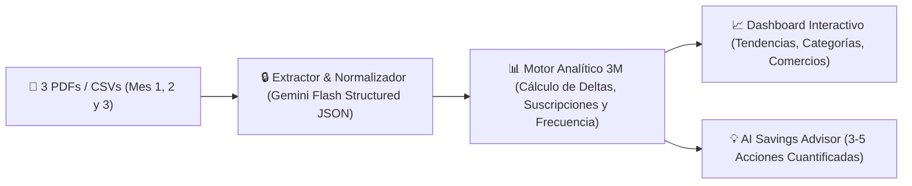

# 📋 Especificación del Proyecto: Card Statement Insights (3-Month Trend Analyzer)

**Objetivo:** Construir en **1 semana (formato Hackathon)** un analizador inteligente de estados de cuenta de tarjeta de crédito que reciba **3 meses consecutivos (PDF/CSV)**, construya un dashboard interactivo de tendencias trimestrales y proponga recortes concretos y cuantificados para gastar menos el próximo mes.

---

## 1. Alcance del MVP (Qué entra y qué NO entra en 1 semana)

### ✅ In-Scope (Lo que sí construiremos)
1. **Carga Multi-Archivo (3 Estados de Cuenta):** Dropzone para subir 3 archivos PDF o CSV correspondientes a los últimos 3 meses (más un botón de *"Probar con 3 Estados de Cuenta Demo"* para evaluación instantánea).
2. **Parser Universal Basado en IA + Redacción de Privacidad:**
   - Extracción automática de transacciones (`fecha`, `comercio_original`, `comercio_limpio`, `categoria`, `monto`, `es_recurrente`, `es_msi`) usando capacidades multimodales de LLM sobre el texto/PDF sin depender de expresiones regulares frágiles por banco.
   - Ofuscación automática de números de tarjeta y datos sensibles antes de guardar en sesión.
3. **Motor de Tendencias de 3 Meses (3-Month Trend Engine):**
   - **Velocidad por Categoría (MoM Growth):** Qué categorías subieron consistentemente del Mes 1 al Mes 2 y al Mes 3 (*Creeping Categories*).
   - **Radar de Suscripciones y "Suscripciones Silenciosas":** Cargos que se repiten cada mes en la misma fecha o que subieron de precio en el Mes 3.
   - **Índice de Gasto Hormiga & Frecuencia por Comercio:** Comercios pequeños (< $15 USD) pero con alta frecuencia mensual (cafeterías, apps de transporte, tiendas de conveniencia).
   - **Peso de Meses Sin Intereses (MSI):** Qué porcentaje del pago mensual ya está comprometido en cuotas fijas vs. compras nuevas.
4. **Generador de Sugerencias Accionables ("Tu Plan para Gastar Menos"):**
   - Tarjetas de recomendación que citan los comercios reales del usuario y calculan el **Ahorro Potencial Mensual y Anual** si aplica el ajuste.

### ❌ Out-of-Scope (Para evitar retrasos en la semana)
- Conexión bancaria directa vía credenciales bancarias (Open Banking en vivo suele requerir aprobaciones largas; el PDF/CSV funciona con cualquier banco desde el día 1).
- Almacenamiento permanente en la nube de los PDFs originales (todo se procesa en memoria o `localStorage`/SQLite efímero por privacidad).

---

## 2. Arquitectura Técnica Recomendada



### Esquema JSON de Salida por Transacción y Resumen Trimestral
```json
{
  "statements_summary": [
    { "month": "2026-07", "total_spent": 18450.00, "transaction_count": 42 },
    { "month": "2026-08", "total_spent": 21100.00, "transaction_count": 49 },
    { "month": "2026-09", "total_spent": 24320.00, "transaction_count": 58 }
  ],
  "three_month_trends": {
    "fastest_growing_category": {
      "category": "Delivery & Restaurantes",
      "m1": 3200,
      "m2": 4500,
      "m3": 6100,
      "growth_pct": 90.6
    },
    "recurring_subscriptions": [
      { "merchant": "Streaming Plus", "monthly_avg": 299, "status": "Aumentó +$50 en Mes 3" },
      { "merchant": "Gym Fit", "monthly_avg": 899, "status": "Recurrente fijo" }
    ],
    "micro_spend_drains": {
      "merchant": "Uber Eats / Cafeterías",
      "total_3m_visits": 34,
      "avg_ticket": 165,
      "total_3m_amount": 5610
    }
  },
  "savings_recommendations": [
    {
      "title": "Tope semanal en Delivery (subió 90% en 3 meses)",
      "evidence": "Pasaste de 8 pedidos en Julio ($3,200) a 17 pedidos en Septiembre ($6,100).",
      "action": "Limitar pedidos entre semana a máximo 2 por semana (nivel de Julio).",
      "estimated_monthly_savings": 2900
    }
  ]
}
```

---

## 3. Plan de Trabajo de 1 Semana (Día a Día)

| Día | Meta Principal | Entregable |
| :--- | :--- | :--- |
| **Día 1** | Parser Multimodal de PDFs a JSON + Datos Demo | Endpoint que recibe 3 PDFs de estado de cuenta (o carga 3 PDFs sintéticos realistas) y devuelve el JSON limpio y categorizado. |
| **Día 2** | Motor de Tendencias de 3 Meses | Lógica determinista que agrupa Mes 1, Mes 2 y Mes 3 por categoría y comercio para detectar crecimientos sostenidos, suscripciones y compras hormiga. |
| **Día 3** | Dashboard Visual (Gráficas de Tendencia) | Tarjetas KPI (Gasto Total Trimestral, Categoría en Alerta, Total en Suscripciones) + Gráfica de líneas/barras apiladas comparando Mes 1 vs Mes 2 vs Mes 3. |
| **Día 4** | Generador de Sugerencias y "Simulador de Recorte" | Panel de recomendaciones con switches interactivos: el usuario activa/desactiva sugerencias y ve cuánto bajaría su próximo estado de cuenta en tiempo real. |
| **Día 5** | Tabla Exploradora de Transacciones y Anomalías | Buscador por comercio, filtro de cargos duplicados o atípicos (*Outliers*), y etiqueta de privacidad ("Tus PDFs no se guardan en ningún servidor"). |
| **Día 6** | Pulido de UI/UX y Pruebas con Distintos Bancos | Probar extracción con formatos variados (BBVA, Nu, Citibanamex, Santander o CSVs genéricos) y afinar colores/micro-interacciones. |
| **Día 7** | Demo y Pitch | Flujo en vivo: arrastrar 3 PDFs -> ver en 5 segundos cómo el dashboard revela $3,500/mes de ahorro oculto. |

---

## 4. Qué hace ganador a este proyecto en un Hackathon
1. **Cero Fricción Bancaria:** Nadie quiere dar su contraseña del banco a una app de hackathon, pero todos pueden arrastrar 3 PDFs o probar el set demo en un clic.
2. **Enfoque en "Tendencia de 3 Meses" (No foto estática):** Ver un solo mes no dice si vas mejor o peor; comparar 3 meses revela el *momentum* del gasto (qué se está saliendo de control antes de que sea tarde).
3. **Sugerencias con Evidencia Real y Simulador Interactivo:** En lugar de consejos genéricos ("ahorra el 20%"), le dice al usuario exactamente qué comercio o hábito trimestral recortar y cuánto dinero recupera el próximo mes.
