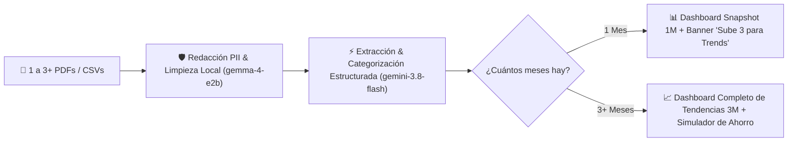

# 📋 Especificación del Proyecto: Card Statement Insights (1-to-3+ Statements Progressive Analyzer)

**Objetivo:** Construir en **1 semana (formato Hackathon)** un dashboard de análisis de tarjetas de crédito sumamente visual que **funcione desde el primer estado de cuenta (1 PDF/CSV)** entregando valor inmediato, y que **recomiende e incentive subir mínimo 3 estados de cuenta** para desbloquear la detección de tendencias (*trends*) multi-mes.

---

## 1. Experiencia Progresiva: De 1 Estado de Cuenta a 3+ Estados de Cuenta

Para maximizar la conversión y facilidad de uso, la aplicación nunca bloquea al usuario si solo tiene 1 archivo a la mano:

| Cantidad de Archivos Subidos | Modo del Dashboard | Qué ve el usuario (Outputs) | Call-to-Action Progresivo |
| :--- | :--- | :--- | :--- |
| **1 Estado de Cuenta** | **Modo Radiografía (Snapshot 1M)** | • Distribución por categoría (Donut Chart) • Top 5 comercios de mayor gasto • Detector de Gastos Hormiga del mes (frecuencia > 4 visitas) • Identificación de cargos recurrentes/suscripciones y MSI • Top 3 recomendaciones rápidas de ahorro para el próximo corte. | Indicador visual `1/3 meses cargados`: *"💡 Consejo: Sube 2 estados de cuenta anteriores para activar el **Radar de Tendencias Trimestrales** y descubrir qué gastos están creciendo mes a mes."* |
| **2 Estados de Cuenta** | **Modo Comparativo (Mes vs. Mes)** | • Todo lo anterior + Variación porcentual Mes 1 vs. Mes 2 ($\Delta\%$). | Indicador `2/3 meses cargados`: *"¡Casi listo! Agrega 1 estado de cuenta más para confirmar tendencias reales (mínimo 3 meses) y descartar picos aislados."* |
| **3+ Estados de Cuenta (Óptimo)** | **Modo Tendencias Completo (3-Month Trend Engine)** | • **Gráfica de Evolución 3M por Categoría** • **Alerta de *Lifestyle Creep*** (categorías que subieron 2 meses seguidos) • **Detector de Inflación en Suscripciones** (cargos recurrentes que subieron de precio) • **Plan de Ahorro con Simulador Interactivo** basado en el promedio y tendencia trimestral. | Badge verde: *"✅ Análisis de Tendencias Trimestrales Activo (3/3 meses)"*. |

---

## 2. Arquitectura Técnica y Rol de `gemini-3.8-flash` + `gemma-4-e2b`

### Uso de Modelos
1. **`gemma-4-e2b` (Privacidad & Normalización Rápida):**
   - Limpia texto crudo de estados de cuenta eliminando números de cuenta/tarjeta, nombres y domicilios antes de enviarlo al análisis profundo, y normaliza nombres de comercios sucios (`CLIP*TAQUERIA EL PASO 092` → `Taquería El Paso`).
2. **`gemini-3.8-flash` (Extracción Multimodal + Insights Financieros):**
   - Convierte las tablas de 1, 2 o 3+ estados de cuenta en un JSON tipado estricto y genera las sugerencias accionables cuantificadas (con ahorro estimado en `$`).

---

## 3. Diseño del Dashboard (Fácil de Consumir)

Para evitar tablas saturadas de números, el dashboard se organiza en **4 bloques visuales**:
1. **Header con Medidor de Profundidad de Análisis (`1/3`, `2/3`, `3/3 Estados de Cuenta`)** + Botones rápidos para cargar *"Demo 1 Mes"* o *"Demo 3 Meses (Tendencias Completas)"*.
2. **Fila de 4 KPIs Clave:**
   - 💰 **Gasto Total del Corte (y Promedio 3M si hay 3 meses)**
   - 📈 **Categoría de Mayor Crecimiento / Mayor Peso**
   - 🔄 **Drenaje en Suscripciones y Cargos Fijos**
   - 🐜 **Total en Gastos Hormiga (< $200 MXN / < $12 USD de alta frecuencia)**
3. **Panel Central de Gráficas:**
   - Si hay **1 mes**: Gráfica de barras horizontales por categoría + Treemap de comercios.
   - Si hay **3+ meses**: Gráfica de líneas/barras agrupadas (`Mes 1 vs Mes 2 vs Mes 3`) destacando en rojo las categorías con pendiente positiva sostenida.
4. **Simulador "Cuánto Puedes Ahorrar el Próximo Mes" (Interactivo):**
   - Lista de 3 a 5 tarjetas de acción con un *toggle switch* cada una (ej. `[x] Reducir pedidos de Delivery de 16 a 8 al mes -> Ahorras $1,850/mes`). Al activarlas, un contador grande muestra tu **Nuevo Estado de Cuenta Proyectado**.
